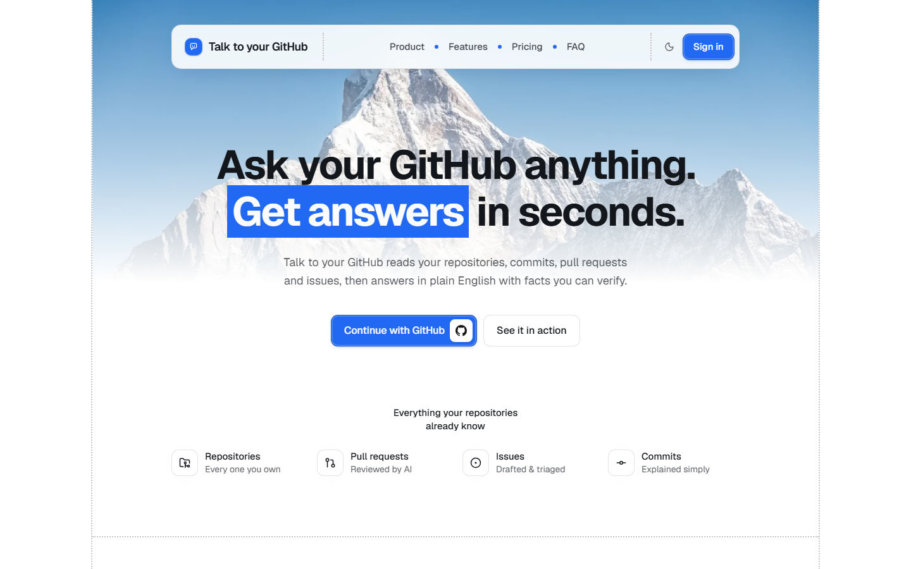
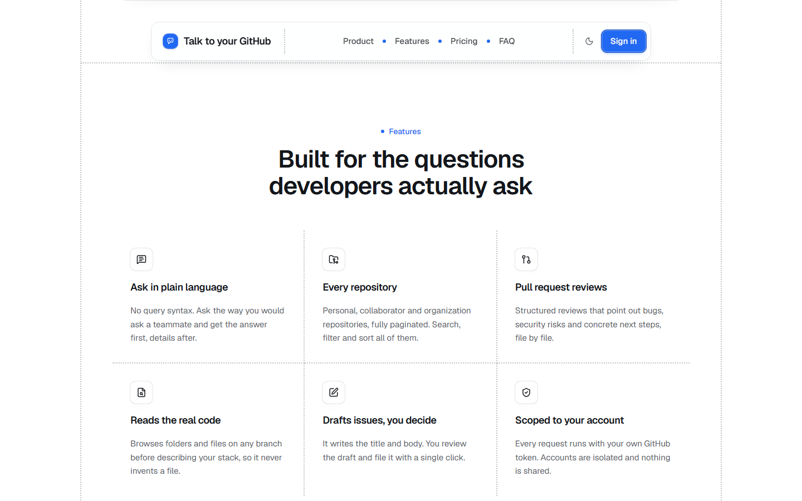
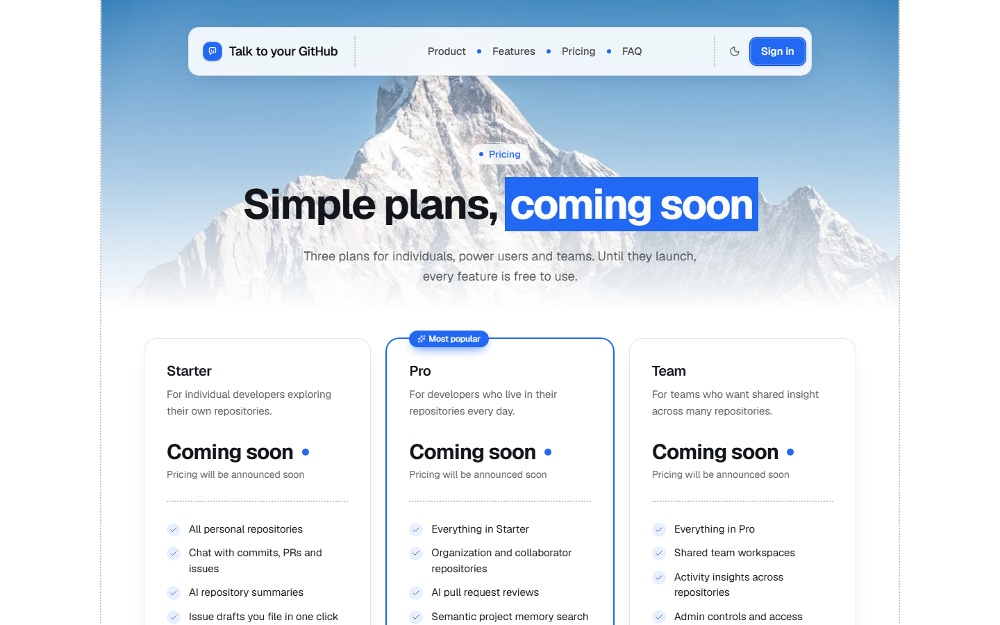
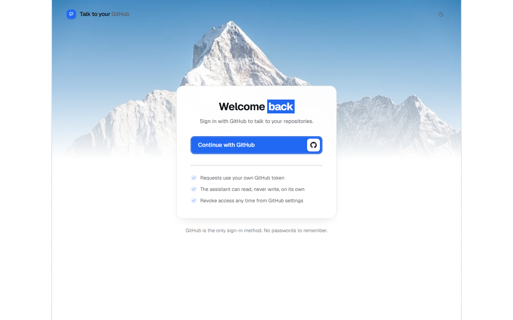

# Talk to your GitHub

Ask your GitHub repositories anything and get answers in plain English.

Talk to your GitHub connects to your GitHub account and lets you chat with every repository you can access. It reads commits, branches, pull requests, issues and code through the GitHub API, then answers with facts you can verify. Responses are kept short and token usage is kept low by design.

## Screenshots

### Landing page



### Features



### Pricing



### Sign in



## Features

- **Chat with your repositories.** Ask about one repository or all of them. Each conversation is saved and restored when you come back.
- **Every repository, fully paginated.** Personal, collaborator and organization repositories are all listed. The dashboard lets you search, filter, sort and page through them, and the reload button fetches a fresh list from GitHub.
- **Live GitHub tools.** The assistant calls only the tools it needs: repositories, branches, commits, pull requests, issues, files and folders.
- **AI pull request reviews.** Ask for a review of any pull request by number and get a short summary, potential issues, security flags and suggestions.
- **Issue drafts you control.** The assistant can draft an issue, but it is only created when you click Create issue on the draft. The assistant itself never writes to GitHub.
- **Repository summaries.** Short AI summaries are generated in the background and shown on each repository page.
- **Project memory.** Commits, pull requests, issues and README content are embedded so the assistant can answer history and "why" questions.
- **Overview dashboard.** Repository counts, activity in the last 30 days, open issues and pull requests, stars, primary languages, recent activity and a full repository table.
- **Pricing page.** Starter, Pro and Team plans are listed as coming soon. Every feature is free until pricing launches.
- **Light and dark themes.** Light by default, with a theme toggle on every page.

## Token efficiency

Every chat request is designed to use as few tokens as possible.

| Area | What it does |
|---|---|
| System prompt | About 200 tokens of focused rules |
| History | Only the last 8 messages are sent, as plain text |
| Tool results | Trimmed to the fields an answer needs |
| File reads | Capped at 6,000 characters |
| Replies | Capped at 700 tokens, answer first |
| Background jobs | Short prompts, limited to the 10 most recently active repositories per run |

## Security

- Every GitHub request uses the signed in user's own OAuth token. No shared server token is used.
- Each account's data is isolated. Background jobs only run for a known user.
- Repository names and file paths are validated before they reach the GitHub API.
- Webhooks are only processed for known accounts, and signatures are verified when `GITHUB_WEBHOOK_SECRET` is set.
- Sign in redirects only ever stay on this site.
- Links in chat replies and README previews are restricted to safe destinations.

## Tech stack

| Category | Technology |
|---|---|
| Framework | Next.js 16 (App Router) |
| Language | TypeScript |
| AI | Vercel AI SDK with OpenAI or OpenRouter |
| Vector search | Pinecone, with a PostgreSQL fallback |
| Text splitting | LangChain RecursiveCharacterTextSplitter |
| Background jobs | Inngest |
| Database | Neon PostgreSQL with Drizzle ORM |
| Authentication | Better Auth (GitHub OAuth only) |
| Tenant setup and webhooks | Corsair |
| UI | Tailwind CSS v4, Radix UI, shadcn/ui, Motion |
| Deployment | Vercel |

## Architecture

```
Browser
  |
  v
Next.js App Router
  |
  +-- /                        Landing page
  +-- /pricing                 Pricing page
  +-- /sign-in                 GitHub sign in
  +-- /dashboard               Overview dashboard
  +-- /chat                    Assistant across all repositories
  +-- /repositories/[o]/[n]    Repository overview, assistant and activity
  |
  +-- /api/chat                Streaming chat with tool calls
  +-- /api/chat/history        Saved conversation for a repository
  +-- /api/repositories        Full repository list (refresh=1 forces a reload)
  +-- /api/repositories/[o]/[n] Repository details, stats and summary
  +-- /api/issues              Creates an issue after the user clicks Create issue
  +-- /api/inngest             Inngest endpoint
  +-- /api/inngest/trigger     Queues a background sync
  +-- /api/webhooks            GitHub webhook receiver
  |
  v
GitHub REST API (user's own token)

Inngest background functions
  +-- generateRepoSummary
  +-- generateEmbeddings
  +-- updateActivityLog
  +-- generateContinueWorking

Neon PostgreSQL
  +-- user, account, session, verification
  +-- github_connections
  +-- conversations, messages
  +-- repository_summaries
  +-- activity_logs
  +-- embeddings

Pinecone
  +-- Per user embeddings for semantic search
```

## Assistant tools

| Tool | Description |
|---|---|
| `getRepositories` | Lists the user's repositories, most recently pushed first |
| `getBranches` | Lists branch names |
| `getCommits` | Recent commits with sha, message, author and date |
| `getPullRequests` | Lists pull requests by state |
| `getIssues` | Lists issues by state, excluding pull requests |
| `getFileContent` | Reads a file or lists a folder on any branch |
| `reviewPullRequest` | AI review of a single pull request |
| `getRepositorySummary` | Stored AI summary for a repository |
| `getProjectMemory` | Semantic search over indexed project history |
| `draftIssue` | Drafts an issue for the user to create with one click |

## Background functions

| Function | Trigger events |
|---|---|
| `generateRepoSummary` | `github.connected` |
| `generateEmbeddings` | `github.connected`, `embeddings.generate` |
| `updateActivityLog` | `github.connected`, `github.webhook`, `activity.update` |
| `generateContinueWorking` | `activity.continue_working` |

Each function is debounced per user and repository, so bursts of events collapse into a single run.

## Getting started

### Prerequisites

- Node.js 20 or newer, and pnpm
- A Neon PostgreSQL database
- A GitHub OAuth App
- An Inngest account
- A Pinecone index
- An OpenAI or OpenRouter API key
- A Corsair KEK

### Installation

```bash
git clone https://github.com/therajarshichakraborty/TalkToYourGithub.git
cd TalkToYourGithub
pnpm install
```

### Environment variables

Create a `.env` file in the project root:

```env
# Database
DATABASE_URL="postgresql://..."
DATABASE_URL_POOLED="postgresql://..."

# Corsair
CORSAIR_KEK="..."

# Authentication
BETTER_AUTH_SECRET="..."
BETTER_AUTH_URL="http://localhost:3000"
GITHUB_CLIENT_ID="..."
GITHUB_CLIENT_SECRET="..."

# Optional: verifies GitHub webhook signatures
GITHUB_WEBHOOK_SECRET="..."

# AI
OPENROUTER_API_KEY="..."
OPENAI_API_KEY="..."

# Pinecone
PINECONE_INDEX="..."
PINECONE_API_KEY="..."
PINECONE_HOST_NAME="..."

# Inngest (local development only)
INNGEST_DEV="1"
```

### GitHub OAuth apps

Use one OAuth app per environment, because a GitHub OAuth app accepts only one callback URL.

| Environment | Authorization callback URL |
|---|---|
| Local | `http://localhost:3000/api/auth/callback/github` |
| Production | `https://your-app.vercel.app/api/auth/callback/github` |

`BETTER_AUTH_URL` must match the address you open in the browser, or GitHub will reject the sign in with an invalid redirect URI error.

### Database setup

```bash
pnpm db:push
```

### Run locally

```bash
# Terminal 1: Next.js
pnpm dev

# Terminal 2: Inngest dev server
npx inngest-cli@latest dev
```

Open [http://localhost:3000](http://localhost:3000).

### Useful scripts

| Command | Purpose |
|---|---|
| `pnpm dev` | Start the development server |
| `pnpm build` | Production build |
| `pnpm lint` | Run ESLint |
| `pnpm db:push` | Push the Drizzle schema to the database |
| `pnpm db:studio` | Open Drizzle Studio |

## Deployment

The project is built to deploy on Vercel.

1. Push the repository to GitHub.
2. Import the project in Vercel.
3. Add the environment variables listed above, using your production OAuth app.
4. Set `BETTER_AUTH_URL` to your production URL.
5. Leave out `INNGEST_DEV` and add `INNGEST_SIGNING_KEY` and `INNGEST_EVENT_KEY` from the Inngest dashboard.
6. Deploy.
7. In the Inngest dashboard, sync the app at `https://your-app.vercel.app/api/inngest`.
8. Set the production OAuth app callback URL to `https://your-app.vercel.app/api/auth/callback/github`.

## License

MIT

## Author

Built by [Rajarshi Chakraborty](https://github.com/therajarshichakraborty).
