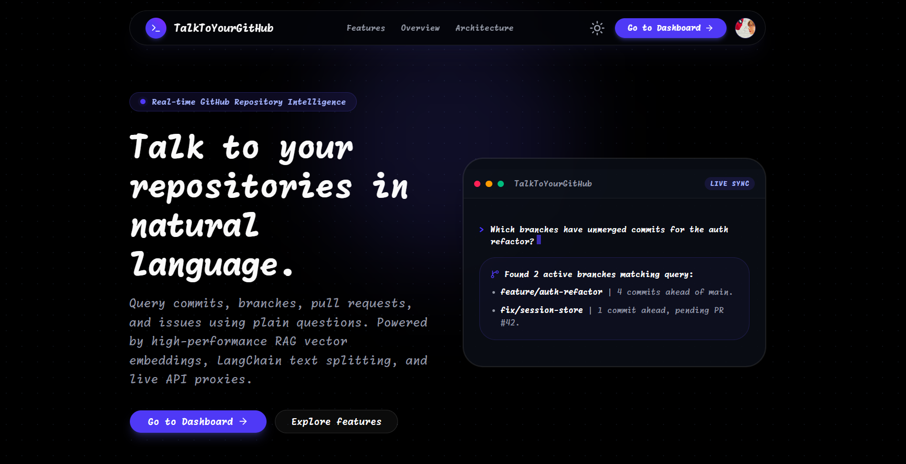

# TalkToYourGitHub

**Real-time GitHub repository intelligence powered by natural language.**

Query your commits, branches, pull requests, and issues using plain questions. TalkToYourGitHub combines a live GitHub API proxy, RAG vector embeddings, LangChain text splitting, and background Inngest pipelines to give you an AI assistant that truly understands your codebase.

---

## What It Does

TalkToYourGitHub connects to your GitHub account and lets you interact with all your repositories through a conversational AI interface. Instead of navigating GitHub manually, you ask questions and get precise, context-aware answers drawn directly from your live repository data.

- Ask which branches have unmerged commits
- Get a summary of recent pull request activity
- Find open issues related to a specific feature
- Resume work on any repository from a smart "Continue Working" dashboard card
- Explore file content and repository structure through chat

---

## Screenshots

### Landing Page



### Dashboard


---

## Tech Stack

| Category | Technology |
|---|---|
| Framework | Next.js 16 (App Router) |
| Language | TypeScript |
| AI / LLM | Vercel AI SDK, OpenRouter, OpenAI |
| Vector Search | Pinecone, pgvector |
| Text Splitting | LangChain RecursiveCharacterTextSplitter |
| Background Jobs | Inngest |
| Database | Neon PostgreSQL (via Drizzle ORM) |
| Authentication | Better Auth (GitHub OAuth) |
| GitHub Proxy | Corsair |
| UI | Tailwind CSS v4, Radix UI, shadcn/ui, Framer Motion |
| Deployment | Vercel |

---

## Features

**AI Chat Interface**
Conversational interface bound to any repository. Each session is persisted in the database and restored on reload.

**Live GitHub Tool Calls**
The AI model calls structured tools in real time: `getRepositories`, `getBranches`, `getCommits`, `getPullRequests`, `getIssues`, `getFileContent`, `createIssue`, `reviewPullRequest`.

**AI Pull Request Review**
Request an automated code review for any pull request by number. The model analyzes the diff and returns structured sections covering summary, positives, potential bugs, security flags, and recommendations.

**RAG Vector Memory**
Repository content is chunked using LangChain, embedded via OpenAI, and stored in both Pinecone and pgvector. The `getProjectMemory` tool performs semantic search across all stored embeddings.

**AI Repository Summaries**
Inngest background functions generate detailed 3-paragraph summaries of each repository using live commit history, branches, pull requests, issues, and README content.

**Continue Working Dashboard**
A developer productivity dashboard that groups all repositories by recent activity, surfaces AI-generated summaries, and generates context-aware "Continue Working" cards to help you resume exactly where you left off.

**Activity Log Pipeline**
Every chat interaction, commit, pull request, and issue is logged to the activity table. The Inngest pipeline keeps this data fresh automatically on every GitHub sync event.

**Multi-Tenant Isolation**
Each user's data is strictly scoped through Corsair's `withTenant()` architecture. No repository data is shared across user accounts.

---

## Architecture

```
User Browser
    |
    v
Next.js App Router (Vercel)
    |
    +-- /api/chat           AI chat with tool calling (Vercel AI SDK streamText)
    +-- /api/repositories   Repository list with DB + API fallback chain
    +-- /api/inngest        Inngest serve endpoint
    +-- /api/webhooks       GitHub webhook receiver
    |
    v
Corsair GitHub Proxy
    |
    +-- Synced local DB (corsair_entities)
    +-- Live GitHub API fallback
    |
    v
Inngest Background Functions
    |
    +-- generateRepoSummary      (github.connected)
    +-- generateEmbeddings       (github.connected, embeddings.generate)
    +-- updateActivityLog        (github.connected, github.webhook, activity.update)
    +-- generateContinueWorking  (activity.continue_working, github.connected)
    |
    v
Neon PostgreSQL (Drizzle ORM)
    |
    +-- users, accounts, sessions
    +-- conversations, messages
    +-- repositorySummaries
    +-- activityLogs
    +-- embeddings (pgvector)

Pinecone Vector Index
    +-- Per-user embeddings for semantic search
```

---

## Getting Started

### Prerequisites

- Node.js 20+ or Bun
- A Neon PostgreSQL database
- A GitHub OAuth App
- An Inngest account
- A Pinecone index
- An OpenRouter or OpenAI API key
- A Corsair account and KEK

### Installation

```bash
git clone https://github.com/therajarshichakraborty/TalkToYourGithub.git
cd TalkToYourGithub
pnpm install
```

### Environment Variables

Create a `.env` file at the project root:

```env
# Database
DATABASE_URL="postgresql://..."
DATABASE_URL_POOLED="postgresql://..."

# Corsair
CORSAIR_KEK="..."

# Authentication
BETTER_AUTH_SECRET="..."
BETTER_AUTH_URL="http://localhost:3000"
GITHUB_CLIENT_ID="..."
GITHUB_CLIENT_SECRET="..."

# GitHub
GITHUB_TOKEN="..."

# AI
OPENROUTER_API_KEY="..."
OPENAI_API_KEY="..."

# Pinecone
PINECONE_INDEX="..."
PINECONE_API_KEY="..."
PINECONE_HOST_NAME="..."

# Inngest (local dev only)
INNGEST_DEV="1"
```

### Database Setup

```bash
pnpm db:push
```

### Run Locally

```bash
# Terminal 1: Next.js dev server
pnpm dev

# Terminal 2: Inngest dev server
npx inngest-cli@latest dev
```

Open [http://localhost:3000](http://localhost:3000).

---

## Deployment

This project is designed to deploy on Vercel.

1. Push your repository to GitHub
2. Import the project in Vercel
3. Add all environment variables listed above
4. Set `BETTER_AUTH_URL` to your production Vercel URL
5. Remove `INNGEST_DEV` from production environment variables
6. Add `INNGEST_SIGNING_KEY` and `INNGEST_EVENT_KEY` from your Inngest production dashboard
7. Deploy
8. In the Inngest dashboard, sync your app at `https://your-app.vercel.app/api/inngest`
9. Update your GitHub OAuth App callback URL to `https://your-app.vercel.app/api/auth/callback/github`

---

## Inngest Functions

| Function | Trigger Events |
|---|---|
| `generateRepoSummary` | `github.connected` |
| `generateEmbeddings` | `github.connected`, `embeddings.generate` |
| `updateActivityLog` | `github.connected`, `github.webhook`, `activity.update` |
| `generateContinueWorking` | `activity.continue_working`, `github.connected` |

---

## Available Tools

The AI assistant has access to the following tools during chat:

| Tool | Description |
|---|---|
| `getRepositories` | Lists all synced repositories for the authenticated user |
| `getBranches` | Lists branches in a specific repository |
| `getCommits` | Fetches recent commit history |
| `getPullRequests` | Lists pull requests with state filtering |
| `getIssues` | Lists issues with state filtering |
| `getFileContent` | Reads file content or lists directory structure |
| `createIssue` | Creates a new GitHub issue |
| `reviewPullRequest` | Performs an AI code review on a specific PR |
| `getRepositorySummary` | Fetches pre-generated AI summary from the database |
| `getProjectMemory` | Semantic vector search across repository embeddings |

---

## License

MIT License. See [LICENSE](./LICENSE) for details.

---

## Author

Built by [Rajarshi Chakraborty](https://github.com/therajarshichakraborty).
